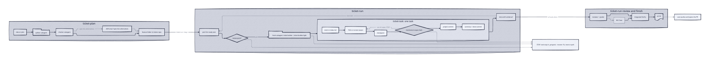

# Ticket workflow

Three opencode skills turn an implementation plan into tracked tasks in a separate
tickets repository, execute them one per fresh subagent, then gate completion on
evidence and write a PR description. `ticket-plan` splits the plan into a feature
folder, `ticket-run` coordinates one task at a time, and `ticket-task` implements
exactly one task. The tickets repo is the durable memory between agents.

## The three skills

| Skill | Role | Who runs it |
|-------|------|-------------|
| `ticket-plan` | Turns a plan into a feature folder in the tickets repo: split, check, optional ADR, commit. | You |
| `ticket-run` | Coordinator: picks ready tasks, dispatches one subagent each, runs the review round and writes `pr.md`. | You |
| `ticket-task` | Implements exactly one task, verifies it and commits it. | A fresh subagent per task |

## Where state lives

Two repositories are involved:

- The **project repo** holds the code, tests and ADRs. All implementation commits
  land here, on the feature branch named in `index.md`.
- The **tickets repo** holds the feature folder: plan, tasks, statuses, review and
  the PR description.

The tickets repo defaults to `eana/agent-tickets`. A line
`Tickets repo: <org/repo | absolute path>` in the project's `AGENTS.md` overrides
it. It is synced on its default branch with `git pull --ff-only` before any write; a
failed fast-forward is a STOP, never a merge or rebase.

The project path inside the tickets repo is computed from the project's `origin`
remote, never derived by hand:

- `git@github.com:o/r.git` and `https://github.com/o/r` both become `github.com/o/r`.
- No `origin` becomes `local/<directory name>`.

The feature folder is
`<tickets repo>/<host>/<owner>/<repo>/<YYYY-MM-DD>-<slug>/`.

Tickets commits stage only the feature folder. Nothing is pushed: the user pushes
both repos.

## Feature folder layout

| File | Purpose |
|------|---------|
| `index.md` | Single source of truth for status and dependencies |
| `plan.md` | The plan being executed, copied verbatim |
| `spec.md` | Optional design or spec document |
| `TNN-<kebab-name>.md` | One task file per plan task |
| `R01-review-fixes.md` | Optional fix task created from accepted review findings |
| `review.md` | Findings, one verdict per finding, post-review verify lines |
| `pr.md` | Final PR description, written last |

`index.md` header fields: Project and branch, Spec, Plan, ADR, Verify. The task
table has columns ID, Title, Status, Depends on, Review point, Complexity.

Status values, nothing else: `open`, `in_progress`, `done`, `blocked`. A task is
ready when it is `open` and every `Depends on` ID is `done`.

## End to end

1. **Plan.** The plan comes from the user or from the writing-plans skill. It has
   one `### Task N: <title>` heading per task.
1. **Split.** A splitter subagent writes one task file per plan task plus
   `index.md`, copying each task's plan text verbatim.
1. **Check.** A separate checker subagent compares the folder against the plan and
   the format, and reports mismatches without editing.
1. **ADR.** Only when `spec.md` lists two or more alternatives under a heading
   containing `Approach`, `Option`, `Alternative` or `Decision`. The ADR is
   committed in the project repo and recorded in `index.md`.
1. **Run.** `ticket-run <slug>` picks the first ready task and dispatches a fresh
   subagent running `ticket-task <slug> <ID>`.
1. **Review round.** A reviewer writes findings to `review.md`; a separate grader
   adds one verdict per finding.
1. **R01 fixes.** Accepted findings become `R01-review-fixes.md` and run through the
   same loop as any other task.
1. **Integrated verify.** The feature's `Verify:` commands run on the project
   branch HEAD and their results are appended to `review.md`.
1. **PR description.** `pr.md` is written from the summaries and verdicts. The user
   pushes and opens the PR.

## Task lifecycle

`ticket-task <slug> <ID>` works in this order:

1. **Claim.** Set the task `in_progress` in `index.md` and commit only that file:
   `chore(tasks): start <slug> <ID>`.
1. **Read only what you need.** The task file, the matching plan section and the
   `## Summary` of each task it depends on.
1. **Implement.** TDD when a test can express the acceptance: write the failing
   test, confirm it fails for the expected reason, implement the minimum, confirm it
   passes. Otherwise run the exact commands from `## Acceptance` or `Verify:`. When
   no behavioral test applies, say why in one line and run the commands.
1. **Checkpoint.** After each meaningful step, append
   `- <YYYY-MM-DD HH:MM> <what happened>` under `## Checkpoints`.
1. **Scope check.** Stage the intended files and run the mechanical scope check
   before the project commit. Any file outside `## Scope` is a STOP.
1. **Project commit.** One commit describing what the change does, never the
   process.
1. **Summary.** Write `## Summary` with Why, What, files touched, the
   `Verification:` command and result, and the `Project commit` SHA.
1. **Done.** Set the status `done` and commit the feature folder:
   `chore(tasks): done <slug> <ID>`.

## Coordinator rules

`ticket-run` keeps its context small on purpose:

- It reads only `index.md`, task summaries, last checkpoint lines and verdict lines.
  It never reads code or diffs, and the only commands it runs itself are the
  feature's `Verify:` commands.
- One fresh subagent per task, never parallel, and never implementing a task in the
  coordinator.
- `Complexity` = `low` goes to `ticket-builder-light`; `high` and `R01` go to
  `ticket-builder`. A missing agent falls back to the default subagent.
- A task with `Review point` = `yes` stops the run before that task, unless it is
  the first task of the session.
- A light builder that STOPs on a failing test or verification is retried once on
  the full builder. Any other STOP is relayed to the user.
- A finished task must show a `Project commit:` whose SHA exists and a
  `Verification:` line with the real result. Missing evidence stops the run.

## Review and finish

One review round per feature, mandatory:

1. A fresh reviewer subagent reviews the project range against `spec.md` and
   `plan.md` and writes findings with ID, severity, file:line, problem and suggested
   fix to `review.md`.
1. A separate grading subagent verifies each finding against the code and appends
   one of `Verdict: accept|minor|reject - <reason>`.
1. Accepted findings become `R01-review-fixes.md` plus an `R01` row in `index.md`.
   Minor findings are never part of `R01`; they are carried into `pr.md`.
1. The `Verify:` commands run on the integrated tree and one
   `Post-review verify: <command> -> <result>` line per command is appended to
   `review.md`.

`pr.md` has the sections Why, What, How, Decision record and Open minor findings,
describes the change itself, and must not mention tickets, tasks, reviews or agents;
a documented `grep` enforces that before the commit. Nothing is pushed for the user.

## When a task stops

A STOP means the task stays `in_progress` and its changes stay in place, with no
automatic revert, stash or clean. Recover in one of three ways:

- **Fix and rerun.** Answer the open question or extend `## Scope`, then rerun
  `ticket-task <slug> <ID>`; it resumes from the last checkpoint.
- **Reset.** Revert the task's project changes, set the status `open` and commit
  `chore(tasks): reset <slug> <ID>`.
- **Park.** Revert the project changes, set the status `blocked` and add a
  checkpoint with the reason.

`ticket-run` stops on a scope violation, an unclear task or a failed verification
instead of continuing to the next task.

## Configuration

Agent models come from `module.opencode.ticket.models` in
`modules/common/opencode/interface.nix`:

| Option | Default | Agent |
|--------|---------|-------|
| `planner` | `github-copilot/claude-sonnet-5` | `ticket-planner` (split, check, review, grade) |
| `builder` | `github-copilot/claude-sonnet-5` | `ticket-builder` (high complexity, retries, `R01`) |
| `builderLight` | `github-copilot/claude-haiku-4.5` | `ticket-builder-light` (low complexity) |

The default tickets repo comes from `module.opencode.ticket.ticketsRepo`
(default `eana/agent-tickets`). A `Tickets repo: <org/repo | absolute path>` line
in the project's `AGENTS.md` overrides it per project.

The three agents are generated in `modules/common/opencode/default.nix`. Skills are
installed from `assets/.config/opencode/skills/<name>` through
`modules/common/opencode/skills.nix` when listed in `skills-catalog.nix`.

## Where this documentation lives

This file sits in the `ticket-task` skill at `references/workflow.md` because that
skill owns the canonical tickets-repo locations and the file format, and both other
skills load it for those definitions. The whole skill directory ships to every host.

The `SKILL.md` files are authoritative. When this document and a `SKILL.md`
disagree, the skill wins, and this document is updated in the same change.

Diagram source `diagrams/ticket-workflow.d2` and render
`diagrams/ticket-workflow.svg` are committed together. The SVG is generated, never
hand-edited: the `d2-render` pre-commit hook renders it with
`d2 --layout elk --sketch --theme 1`.
