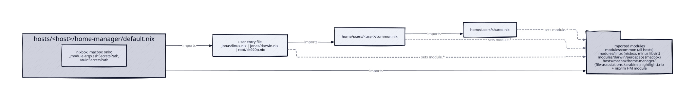

# home

Per-user Home Manager configuration. Each host's Home Manager config imports one user file;
that file imports the user's `common.nix`, which imports `home/users/shared.nix`.

| Host | Entry file | Chain |
| ---- | ---------- | ----- |
| nixbox | `jonas/linux.nix` | `linux.nix` -> `jonas/common.nix` -> `shared.nix` |
| macbox | `jonas/darwin.nix` | `darwin.nix` -> `jonas/common.nix` -> `shared.nix` |
| nasbox | `root/ds920p.nix` | `ds920p.nix` -> `root/common.nix` -> `shared.nix` |

The host files also import the nixvim HM module and the module directories (see
[hosts](../hosts/index.md)). Only nixbox and macbox pass `sshSecretsPath` and
`atuinSecretsPath`.

## shared.nix (every user)

- `home.stateVersion = "26.05"`, `LESS = "-iXFR"`.
- direnv with nix-direnv; nh with `flake = "/etc/nixos"` and weekly `clean`; ssh-agent.
- Packages: axel, tree, unzip, fzf, lazygit, tig, fastfetch.
- `module.git` (ghq root `~/repos`), `module.gpg-agent`, `module.nixvim`
  (`wrapColumn = 120`), `module.tmux`, `module.zsh`.

`/etc/nixos` only exists on nixbox, but every user inherits the nh setting.

## jonas

- `jonas/common.nix` - arguments `sshSecretsPath ? null`, `atuinSecretsPath ? null`.
  Packages fd, lsof, wget, zip, inetutils, net-tools, mpg123, prek, ripgrep, git-absorb,
  jaq, jq, xh, d2, age, telegram-desktop. Session variables `BUILDKIT_PROGRESS = plain`,
  `TERM = xterm-256color`. `custom.theme = "gruvbox"`. Modules:
  - `atuin` - sync to `https://atuin.eana.win`, `credentialsFile = atuinSecretsPath`,
    `sync_frequency = "10m"`, `search_mode = "fuzzy"`.
  - `kitty` - font size 14 and PC-style keybindings matching the Karabiner remap.
  - `opencode` - `package = pkgs.opencode`, `social` skills, playwright, garmin.
  - `podman`.
  - `ssh-client` - `secretsFile = sshSecretsPath`, explicit `KexAlgorithms`.
  - A comment documents the Ollama split: CLI plus remote server on Linux, local server on
    Darwin.
- `jonas/linux.nix` (nixbox) - `systemd.user.startServices = "sd-switch"`; user services
  copyq, telegram, `bluetooth-applet` (blueman), swaynag-battery; GTK theme Yaru
  prussiangreen and dconf font settings; packages including firefox, google-chrome, ollama,
  awscli2, cachix, proton-vpn, freetube, nix-tree and an inline `aws-export-profile`
  derivation (pinned `fetchFromGitHub`); `LIBGL_ALWAYS_INDIRECT = 1`,
  `OLLAMA_HOST = "macbox.local:11434"`. Enables the ten Home Manager modules from
  `modules/linux` (mhalo bound to `Mod4+Shift+m`, openra `red-alert`, sway with
  `swaylock.settings.indicator-radius = 45`, waybar `systemdIntegration`).
- `jonas/darwin.nix` (macbox) - `module.aerospace` with `modifier = "cmd"`; Home Manager's
  own `services.ollama` (there is no repo ollama module) with `OLLAMA_FLASH_ATTENTION`,
  `OLLAMA_KV_CACHE_TYPE = q8_0`, `OLLAMA_NUM_PARALLEL = 1` and
  `OLLAMA_MAX_LOADED_MODELS = 1`; packages cmake, mas, maccy, procps, iproute2mac.

## root (nasbox)

- `root/common.nix` - only imports `../shared.nix`.
- `root/ds920p.nix` - `programs.home-manager.enable`; `module.atuin` with sync to
  `https://atuin.eana.win` and credentials at
  `~/.local/share/atuin/atuin-credentials`; `module.git.identities.default` with
  `sshKey = "~/.ssh/id_ed25519_git"` and `pathPatterns = [ "~/repos/**" ]`; 16 NAS tools
  (for example iftop, iotop, nethogs, iperf, sysstat, zmap, dnsutils, lsof).

### atuin login without systemd (HACK)

DSM provides no working root `systemd --user`, so `ds920p.nix` defines
`home.activation.atuinLogin` (`entryAfter [ "writeBoundary" ]`), which:

1. creates the credentials directory;
1. removes `atuin.eana.win` from `/etc/hosts` and appends `192.168.0.145 atuin.eana.win`;
1. decrypts `secrets/atuin.age` with `age --decrypt -i ~/.ssh/id_ed25519`;
1. sets the credentials file to mode 0400;
1. runs `atuin login` with the parsed username, password and key if `atuin status` fails.

The TODO says to drop this and return to agenix plus the atuin-login user service once DSM
has a working root `systemd --user`.

## Related pages

- [hosts](../hosts/index.md)
- [modules/common](../modules-common/index.md)
- [modules/linux](../modules-linux/index.md)
- [modules/darwin](../modules-darwin/index.md)
