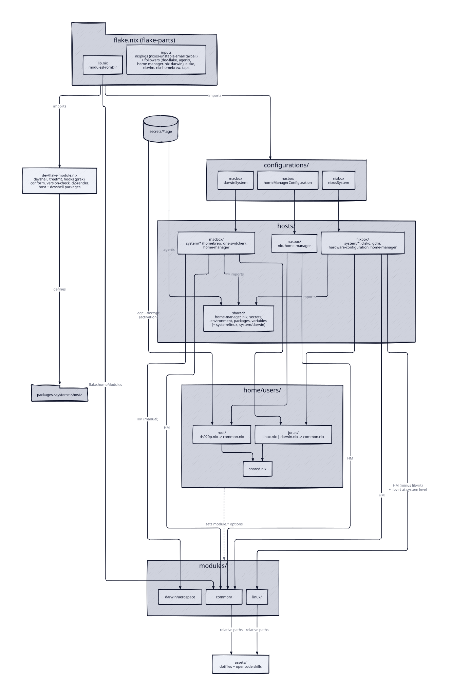

# nix-config architecture

`nix-config` is a single flake that declaratively builds three hosts: `nixbox` (NixOS,
x86_64-linux), `macbox` (nix-darwin, aarch64-darwin) and `nasbox` (a standalone Home
Manager configuration for the root user on a Synology NAS, x86_64-linux). It is built with
[flake-parts](https://github.com/hercules-ci/flake-parts) and the
[terlar/dev-flake](https://github.com/terlar/dev-flake) flake module.

## Root files

| File | Role |
| ---- | ---- |
| `flake.nix` | Declares inputs, `systems = [ "x86_64-linux" "aarch64-darwin" ]`, imports `./dev/flake-module.nix` and the three `configurations/<host>/flake-module.nix`, sets `_module.args.eanaLib`, exports `flake.homeModules` (from `modules/common`), and sets `nixConfig.extra-substituters` / `extra-trusted-public-keys` for `cache.nixos.org`, `eana.cachix.org` and `nix-community.cachix.org`. |
| `flake.lock` | Locked input revisions (maintained by Renovate lockfile maintenance). |
| `lib.nix` | `modulesFromDir dir`: lists `dir` recursively and keeps only `<dir>/<name>/default.nix` (not the top-level `default.nix`, not deeper paths). Kebab-case directory names become camelCase attribute names; values are `import <path>`. |
| `secrets.nix` | agenix recipients: five `jonas-*` user keys and five host keys (macbox, nasbox, newbox, nixbox, oldbox). Each of the four secrets (`home-ssid`, `home-gateway-mac`, `ssh-hosts`, `atuin`) is encrypted to `allUsers ++ allSystems`. `newbox` and `oldbox` have no configuration in this flake. |
| `secrets/*.age` | The four encrypted secret files. |
| `renovate.json5` | See "Dependency updates" below. |
| `.github/workflows/ci.yml` | See "CI" below. |
| `.envrc` | `use flake`, then `unset IN_NIX_SHELL`. |
| `.gitignore` | `/.worktrees`, `/.direnv`, `/.pre-commit-config.yaml`, `/result*`, `secrets/*` except `!secrets/*.age`, `__pycache__/`, and `.wiki-cache*`. |
| `README.md` | Bootstrap procedures: disko install for nixbox, nix-darwin setup for macbox, agenix re-keying after a macOS reinstall plus `launchctl kickstart` recoveries, and the Synology Nix install. |

## Flake inputs

- Follow `nixpkgs` (`nixos-unstable`): `dev-flake`, `agenix`, `home-manager`, `nix-darwin`,
  `nix-index-database`, `pyproject-nix`, `uv2nix`, `pyproject-build-systems`.
- Further follows: `dev-flake` follows `flake-parts`; `uv2nix` follows `pyproject-nix`;
  `pyproject-build-systems` follows `pyproject-nix` and `uv2nix`.
- `pyproject-nix`, `uv2nix` and `pyproject-build-systems` exist only to build the
  `garmin-mcp` package (`modules/common/opencode/packages/garmin-mcp.nix`).
- Own nixpkgs: `disko`, `nixvim`, `nix-homebrew`. `flake-parts` uses
  `nixpkgs-lib` from `github:nix-community/nixpkgs.lib`.
- Non-flake sources (`flake = false`): `homebrew-core`, `homebrew-cask`, `nikitabobko-tap`.

The repo defines no `nixpkgs.overlays`. The only overlay in use is
`pyproject-build-systems.overlays.default`, applied to the Python package set inside
`garmin-mcp.nix`.

## How a change reaches a host

1. `flake.nix` imports `dev/flake-module.nix` and the three configuration modules. Each
   configuration module defines a separate flake attribute.
1. `configurations/<host>/flake-module.nix` instantiates the host
   (`nixosConfigurations.nixbox`, `darwinConfigurations.macbox`,
   `homeConfigurations.nasbox`).
1. `hosts/<host>/default.nix` lists the host's modules. nixbox and macbox import
   `../shared/default.nix` plus `../shared/system/linux.nix` or `../shared/system/darwin.nix`;
   nasbox imports only its own `home-manager/` and `nix/`.
1. The host Home Manager config imports a user file (`home/users/jonas/linux.nix`,
   `home/users/jonas/darwin.nix` or `home/users/root/ds920p.nix`), which imports the user's
   `common.nix`, which imports `home/users/shared.nix`.
1. Module directories: `modules/common` is imported on every host via `modulesFromDir`;
   `modules/linux` (minus `libvirt`) is imported into Home Manager on nixbox, and `libvirt`
   is imported at system level; `modules/darwin/aerospace` is imported by hand on macbox.
1. `dev/flake-module.nix` exposes `packages.x86_64-linux.{nixbox,nasbox}` and
   `packages.aarch64-darwin.macbox`, so `nix build .#<host>` only works on the matching
   system.

## Host matrix

| Aspect | nixbox | macbox | nasbox |
| ------ | ------ | ------ | ------ |
| configuration kind | `nixosSystem` | `darwinSystem` | `homeManagerConfiguration` |
| `hosts/shared` | yes | yes | no |
| user | jonas | jonas | root |
| `modules/common` | yes | yes | yes |
| `modules/linux` | yes (HM, minus `libvirt`; `libvirt` at system level) | no | no |
| `modules/darwin` | no | `aerospace` (manual) | no |
| agenix | yes | yes | no (manual `age --decrypt` in `ds920p.nix`) |

## CI

`.github/workflows/ci.yml` runs on pull requests targeting `master`, pushes to `master`,
and `workflow_dispatch`. Nix is installed at version 2.33.0.

- `pre-commit` job: `nix develop --command bash -c "prek run --all-files"` and
  `version-check --check`.
- `changes` job: `dorny/paths-filter` per host:
  - nixbox: `flake.nix`, `flake.lock`, `home/users/shared.nix`, `home/users/jonas/{common,linux}.nix`,
    `hosts/nixbox/**`, `hosts/shared/**`, `modules/common/**`, `modules/linux/**`.
  - macbox: `flake.nix`, `flake.lock`, `home/users/shared.nix`,
    `home/users/jonas/{common,darwin}.nix`, `hosts/macbox/**`, `hosts/shared/**`,
    `modules/common/**`, `modules/darwin/**`.
  - nasbox: `flake.nix`, `flake.lock`, `home/users/shared.nix`,
    `home/users/root/{common,ds920p}.nix`, `hosts/nasbox/**`, `modules/common/**`, and
    `modules/linux/**` (which nasbox does not import).
- Gaps: no filter covers `lib.nix`, `dev/**`, `assets/**` or `secrets/**`. A change to
  `assets/**` (p10k, mpv configs, sway files, opencode skills) or to `lib.nix` triggers no
  host build.
- Build jobs (Cachix cache `eana`) run when pre-commit passed and the host's filter matched,
  or always on `workflow_dispatch`:
  - nixbox on ubuntu, after `free-disk-space`:
    `.#nixosConfigurations.nixbox.config.system.build.toplevel`
  - macbox on macos: `.#darwinConfigurations.macbox.system`
  - nasbox on ubuntu: `.#homeConfigurations.nasbox.activationPackage`

## Dependency updates

`renovate.json5` extends `:enablePreCommit`, `:semanticCommits`, `config:recommended`,
`helpers:pinGitHubActionDigests` and `schedule:weekdays`; reviewer `@eana`, label
`dependencies`, `platformAutomerge`, vulnerability alerts, and `nix: { enabled: true }`.
Rules: minor and patch updates are grouped (`dev-deps`) and automerged;
`pre-commit/pre-commit-hooks` updates (including majors) are automerged; GitHub Actions are
grouped and automerged. Lockfile maintenance runs weekly with automerge.

## Cross-unit couplings

- `modules/common` is shared by every host and drives the leaf modules: its
  `config.custom.theme` / `config.custom.fonts` options are read by `modules/linux`
  (waybar palette, foot font) and by kitty, nixvim and opencode inside `modules/common`.
- `hosts` and `home` form one chain: host Home Manager configs import the user files and,
  on nixbox and macbox, pass agenix paths in as `_module.args.sshSecretsPath` and
  `atuinSecretsPath`, which `home/users/jonas/common.nix` hands to `module.ssh-client` and
  `module.atuin`.
- `assets` is consumed only through relative paths from modules: zsh (`.p10k.zsh`), opencode
  (skills, `snip/config.toml`, the `repo-wiki` package), sway (`mimeapps.list`, backgrounds)
  and mpv (configs).

## Units

| Unit | Summary |
| ---- | ------- |
| [configurations](configurations/index.md) | Per-host flake-parts modules that instantiate the systems. |
| [hosts](hosts/index.md) | Shared base plus per-host system and Home Manager trees. |
| [modules/common](modules-common/index.md) | Shared Home Manager modules (shell, git/ssh/atuin, podman, nixvim, opencode). |
| [modules/linux](modules-linux/index.md) | Linux modules (sway desktop, media, openra, mhalo, libvirt). |
| [modules/darwin](modules-darwin/index.md) | Darwin module `aerospace`, imported by hand. |
| [home](home/index.md) | Per-user Home Manager wiring ([diagram](diagrams/home-wiring.svg)). |
| [dev](dev/index.md) | Devshell, treefmt, pre-commit, version-check, repo-wiki, repl. |
| [assets](assets/index.md) | Dotfiles and vendored opencode skills. |
